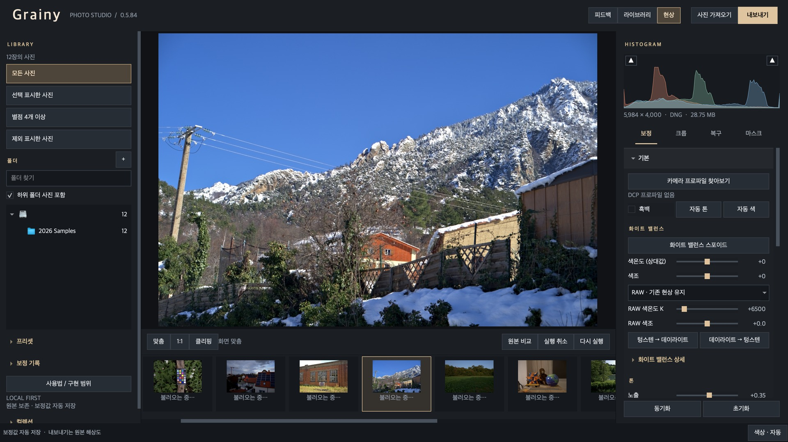
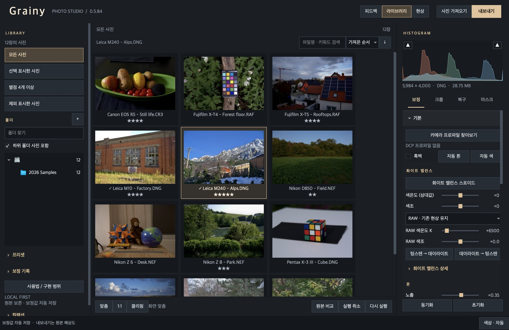
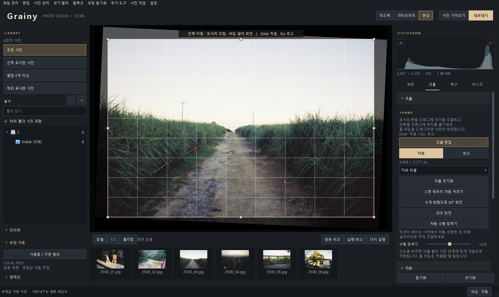
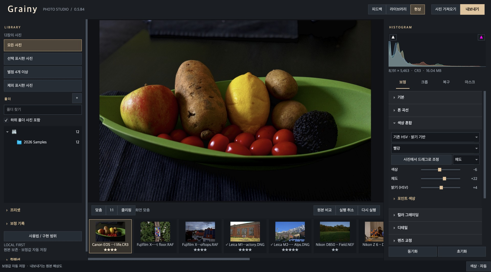
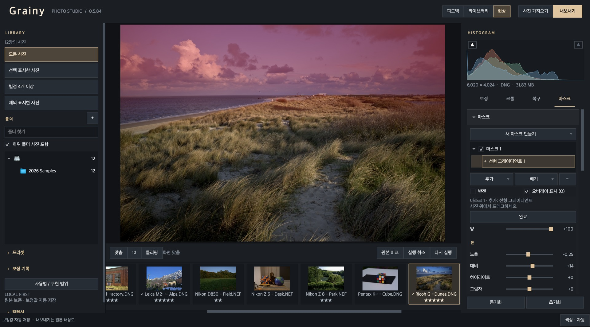

<p align="center">
  
</p>

<h1 align="center">Grainy</h1>

<h3 align="center">필름 스캔을 위해 만든 무료 사진 보정·관리 프로그램</h3>

<p align="center">
  스캔의 색 틀어짐을 버튼 한 번으로 잡고, 먼지를 지우고, 수평을 맞추고, 모든 롤을 한 보관함에서 관리합니다.<br>
  RAW 파일도 됩니다. 계정도 구독도 없고, 사진은 내 컴퓨터 밖으로 나가지 않습니다.
</p>

<p align="center"><b><a href="https://pastorius9.github.io/grainy/">pastorius9.github.io/grainy</a></b></p>

<p align="center">
  <a href="https://github.com/pastorius9/grainy/releases/latest"></a>
  <a href="https://github.com/pastorius9/grainy/releases"></a>
  
  <a href="LICENSE"></a>
</p>

<p align="center">
  <a href="https://github.com/pastorius9/grainy/releases/latest"></a>
  &nbsp;
  <a href="https://github.com/pastorius9/grainy/releases/latest"></a>
</p>

<p align="center"><a href="README.md">English</a> · <b>한국어</b></p>



## 자동 톤과 자동 색

현상소에서 받은 스캔은 밋밋하고, 누렇거나 푸르거나 초록빛으로 틀어져 있을 때가 많습니다. **자동 톤**은 사진의 가장 어두운 곳과 밝은 곳을 맞춥니다. **자동 색**은 어두운 곳, 중간, 밝은 곳을 따로 보고 채널 커브로 각각 바로잡습니다. 필름 스캔은 밝기에 따라 틀어진 정도가 다른 경우가 많아서, 화이트밸런스 값 하나로는 잡히지 않기 때문입니다.


왼쪽은 현상소에서 받은 그대로, 오른쪽은 자동 톤과 자동 색 버튼을 한 번씩 누른 결과입니다. 다른 보정은 하지 않았습니다.

- 공연장 조명이나 네온처럼 원래 색이 있는 빛으로 찍은 사진은 건드리지 않습니다.
- 강도 슬라이더로 보정 정도를 조절합니다. 아주 심하게 틀어진 사진은 완전히 돌아오지 않습니다.
- 텅스텐 필름을 낮에 찍었거나 그 반대인 경우를 위한 변환 버튼이 따로 있습니다.

## 왜 Grainy인가

- **무료, 로컬.** 계정도 구독도 없고 사용 통계를 수집하지 않습니다. 사진과 보정 기록은 내 컴퓨터에만 있고, 원본은 절대 건드리지 않습니다.
- **필름 스캔을 위한 도구.** 네거티브 반전, 자동 색, 먼지·스크래치 자동 감지(지우기 전에 직접 확인), 스캔 테두리 자르기, 그레인.
- **RAW 현상.** 공개 RAW 샘플 15종 중 14종이 열립니다: Canon, Nikon, Fujifilm(X-Trans), Leica, Sony, Panasonic, Olympus, Pentax, Ricoh. Nikon의 고효율(HE) 압축 NEF는 열리지 않습니다.
- **그래픽카드 가속.** Windows는 Direct3D 11, macOS는 Metal을 씁니다. M1 Pro에서 2,400만 화소 사진의 전체 현상(노이즈 제거·선명도 포함)이 CPU만으로 8.2초, 가속을 켜면 1.6초였습니다(한 번 잰 값). 가속 결과는 CPU 결과와 8비트 한 단계 이내로 같습니다.
- **Lightroom에서 옮겨 오기.** 카탈로그(별점·플래그·컬렉션·보정값)와 프리셋을 가져옵니다.

## 화면

### 보관함

폴더를 등록하면 새 사진을 알아서 가져옵니다. 별점, 플래그, 색 라벨, 키워드, 컬렉션과 스마트 컬렉션으로 정리합니다.



### 크롭과 수평 맞추기

자동 수평 맞추기가 각도를 찾아 슬라이더에 넣어 줍니다. 틀 바깥을 끌면 사진이 돌아가고, 빈 모서리가 생기지 않게 크롭 틀이 따라옵니다.



### 톤과 색

노출, 톤 곡선과 채널 곡선, 8색 혼합, 컬러 그레이딩, 카메라 프로파일(DCP), 렌즈 보정(Lensfun). 보정은 저장 버튼 없이 바로 기록되고 단계마다 되돌릴 수 있습니다.



### 부분 보정

브러시, 선형·방사형 그레이디언트, 색상·광도 범위로 영역을 고르고 추가·빼기·교차로 조합합니다. 아래는 하늘에만 건 선형 그레이디언트입니다.



### RAW, 가져온 그대로와 보정 후


왼쪽은 RAW를 가져온 그대로, 오른쪽은 기본 보정과 위의 하늘 마스크를 적용한 결과입니다.

이 문서의 필름 스캔은 만든 사람이 직접 찍은 것입니다. 나머지 사진은 [raw.pixls.us](https://raw.pixls.us)의 CC0 공개 샘플입니다(Leica M (Typ 240), Ricoh GR III, Canon EOS R5 등). 화면은 실제 프로그램을 자동으로 조작해 찍었습니다.

## 받기와 실행

1. Releases에서 `Grainy-<버전>-windows-x64.zip`을 받아 원하는 폴더에 풉니다.
2. `Grainy.exe`를 실행합니다.
3. 코드 서명이 없어 처음 실행할 때 Windows가 "알 수 없는 게시자" 경고를 보여 줍니다.

- Windows 10/11 64비트가 필요합니다.
- 보관함은 `%LOCALAPPDATA%\Luma\Library`에 만들어집니다.

### macOS (Apple Silicon)

1. Releases에서 `Grainy-<버전>-macos-arm64.dmg`를 받아 열고, Grainy를 응용 프로그램 폴더로 끌어다 놓습니다.
2. 처음 실행하면 macOS가 확인되지 않은 개발자의 앱이라며 막습니다. `시스템 설정 → 개인정보 보호 및 보안`에서 "그래도 열기"를 한 번 누르면 됩니다. Apple 개발자 서명과 공증이 없기 때문입니다.

- Apple Silicon(M1 이후) Mac과 macOS 14 이상이 필요합니다. Intel Mac은 지원하지 않습니다.
- 보관함과 설정은 `~/Library/Application Support/Grainy/`에 만들어집니다.
- macOS 버전은 0.5.84가 첫 배포입니다. 자동 시험은 통과했지만 여러 사람의 Mac에서 써 본 것은 아닙니다. 문제는 피드백 버튼으로 알려 주세요.

## 삭제

- 압축을 푼 Grainy 폴더를 지우면 프로그램이 삭제됩니다. 레지스트리나 시스템 설정은 건드리지 않습니다.
- 보정 기록까지 지우려면 `%LOCALAPPDATA%\Luma`(보관함)와 `%LOCALAPPDATA%\Grainy`(설정) 폴더도 지웁니다. 사진 원본은 이 폴더들에 없습니다.
- macOS: 응용 프로그램 폴더의 Grainy를 휴지통으로 옮깁니다. 보정 기록까지 지우려면 `~/Library/Application Support/Grainy` 폴더도 지웁니다.

## 기능

- **보관함**: 폴더 가져오기, 등록한 폴더의 새 사진 자동 가져오기, 별점·색 라벨·키워드, 컬렉션과 스마트 컬렉션, 폴더 위치 복구
- **RAW 현상**: 주요 카메라 RAW, 카메라 프로파일(DCP), 렌즈 보정(Lensfun)
- **네거티브 필름**: 스캔한 네거티브를 버튼 한 번으로 사진으로 바꿉니다(필름 베이스 색을 채널별로 제거). 다른 보정은 반전한 사진에 그대로 적용됩니다. 같은 설정으로 스캔한 한 롤은 한꺼번에 재서 모든 사진의 색 기준을 같게 맞출 수 있습니다
- **필름 룩**: 코닥 포트라·엑타·코다크롬·트라이엑스·비전3, 후지 벨비아·프로비아·아크로스, 일포드 HP5·델타 등 82가지 필름. 제조사가 공개한 기술 자료(분광 감도, 특성 곡선, 염료 농도)로 계산하고, 네거티브는 그 필름용 인화지에 인화한 결과로 보여 줍니다(슬라이드는 필름 그대로). 강도를 조절할 수 있고 그 필름의 입자도 함께 들어갑니다
- **보정**: 노출·톤 커브·채널 커브·색상 혼합·컬러 그레이딩, 자동 톤, 자동 색(색 틀어짐 보정), 필름 색온도 변환(텅스텐↔데이라이트), 톤 매핑 선택(기본·부드러운 하이라이트), 모든 패널의 켜기/끄기 스위치
- **디테일**: 선명도, 노이즈 제거, 그레인, 비네팅
- **부분 보정**: 마스크(하늘 선택, 브러시, 선형·방사형 그레이디언트, 색상·광도 범위, 추가·빼기·교차), 힐링, 먼지 제거
- **단축키**: 도구와 마스크(W, K, M, Shift+M, Q…), 보기(F 전체 화면, L 조명 끄기, Tab 패널 숨기기, Z 1:1, J 클리핑), 자동 톤·자동 색(Ctrl+U, Ctrl+Shift+U), 회전(Ctrl+[ ]), 색 라벨(6–9), <kbd>?</kbd>로 목록 보기
- **내보내기**: JPEG, PNG, TIFF, AVIF, JPEG XL
- **피드백**: 화면 위쪽 버튼으로 문제점이나 개선 아이디어를 바로 보낼 수 있습니다
- **업데이트**: 프로그램 안에서 새 버전을 확인하고 바로 교체합니다
- **AI 연결**: 이 컴퓨터의 AI 프로그램(Claude Code, Codex, Claude 데스크톱)에 명령 한 줄로 Grainy의 MCP를 한 번 설치하면, Grainy가 실행 중일 때 그 프로그램이 Grainy의 기능으로 사진을 가져오고, 찾아보고, 보고, 별점을 매기고, 보정하고(프리셋, 필름 룩, 커브, 보정 복사, 스냅샷, 가상 사본), 내보낼 수 있습니다. AI가 한 보정은 한 번에 하나씩 되돌릴 수 있습니다
- **기타**: 편집 이력과 실행 취소, Lightroom 카탈로그·프리셋 가져오기, 카탈로그 백업(Google Drive 폴더 포함), GPS 지도

브라우저에서 직접 해 보며 배우기: **[pastorius9.github.io/grainy/learn](https://pastorius9.github.io/grainy/learn/)**. 자세한 사용법은 프로그램에 들어 있는 도움말(`README.html`)에 있습니다.

## 개인정보

- 사용 통계를 수집하지 않습니다. 인터넷으로 나가는 것은 아래 두 가지뿐이고, 둘 다 직접 요청했을 때만 동작합니다.
- **피드백 보내기**: 보내기를 누를 때만 입력한 글, Grainy 버전, 컴퓨터 사양 한 줄(운영체제 버전, 그래픽카드 이름), 무작위로 정하는 접수 번호 5자리가 전송됩니다. 접수 번호는 이 컴퓨터에도 남아, 나중에 업데이트하면 보내신 피드백이 반영되었는지 알려 드립니다. 사진, 파일 이름과 경로, 사용자 이름은 보내지 않습니다.
- **업데이트**: "업데이트 확인"을 누르거나 "새 버전 자동 확인"을 켰을 때만 GitHub에서 최신 버전 정보를 읽습니다(자동 확인은 처음 실행할 때 켤지 묻고, 설정에서 끌 수 있습니다). 사용자에 관한 정보는 보내지 않습니다.
- **AI 연결**: Grainy가 실행 중이면 연결은 켜져 있습니다(설정 › AI 연결 (MCP)…에서 끌 수 있습니다). 하지만 이 컴퓨터의 AI 프로그램(Claude Code, Codex, Claude 데스크톱)에 Grainy의 MCP를 설치하고 그 프로그램에 일을 시키지 않으면 아무것도 읽히지 않고 컴퓨터 밖으로 나가지도 않습니다. 설치한 프로그램은 사진 목록과 사진 정보를 읽을 수 있습니다. 사진 정보는 파일 이름과 전체 파일·폴더 경로(사용자 이름 포함), 키워드, 별점, 카메라, 렌즈, 노출 정보, 촬영 날짜이며 GPS 위치는 빠집니다. 보정값과 최대 1568픽셀 미리보기, 최대 36장짜리 밀착 이미지도 읽을 수 있습니다. 또 보정값과 별점·선택 표시·색 라벨을 바꾸고, 스냅샷을 저장·복원하고, 가상 사본을 만들 수 있습니다. 그 프로그램이 정한 폴더의 사진을 보관함으로 가져오고(파일은 읽기만 합니다), AI 내보내기 폴더(바꾸지 않았다면 사진/Grainy), 마지막으로 내보낸 폴더, 또는 그 프로그램이 정한 이 컴퓨터의 다른 폴더(Grainy의 보관함·연결·프로그램 폴더는 제외)로 사본을 내보낼 수 있습니다. 있는 파일을 덮어쓰지는 않습니다. 그 프로그램이 읽은 내용은 그 AI 서비스로 전송되며 대화 기록 등으로 그 프로그램에도 남을 수 있습니다. Grainy 자체는 사진을 어디로도 보내지 않습니다. 연결은 이 컴퓨터 안에서만 열리고 연결 키가 있어야 합니다. 키는 Grainy의 설정 폴더에 그대로 저장되고 설치한 MCP가 거기서 읽으므로, AI 프로그램의 설정에는 들어가지 않습니다(고급에서 HTTP로 직접 연결하도록 설정한 경우는 제외). 원본 파일은 바뀌지 않습니다. AI가 한 보정은 최근 5개 작업까지 최근 것부터 되돌릴 수 있고, 그 뒤 해당 사진을 다시 보정하지 않았을 때만 됩니다. AI가 처음 손댄 사진에는 'AI 작업 전' 스냅샷도 남습니다. 가져오기, 가상 사본, 별점·라벨 변경과 내보낸 파일은 이 되돌리기에 들어가지 않습니다.

## AI 프로그램에서 Grainy 쓰기 (선택)

Grainy는 실행만 되어 있으면 됩니다. 쓰는 AI 프로그램에 Grainy의 MCP를 한 번 설치하세요. 명령은 어느 컴퓨터에서나 같고 연결 키가 들어가지 않습니다. Grainy의 **설정 › AI 연결 (MCP)…** 창에도 같은 명령이 **복사** 버튼과 함께 나옵니다. 설치 전에 Grainy를 한 번 실행하세요. 이 명령이 시작하는 중계 스크립트를 Grainy가 자기 폴더(Windows는 `%LOCALAPPDATA%\Grainy\mcp`, macOS는 `~/Library/Application Support/Grainy/mcp`)에 넣어 둡니다.

1. 쓰는 프로그램에 설치합니다.
   - **Claude Code**: Windows는 PowerShell에서 실행한 뒤 Claude Code를 다시 시작합니다. 확인은 `claude mcp list`.
     ```powershell
     claude mcp add --scope user grainy '--' powershell -NoProfile -ExecutionPolicy Bypass -File "$env:LOCALAPPDATA\Grainy\mcp\grainy-mcp-bridge.ps1"
     ```
     macOS는 터미널에서:
     ```bash
     claude mcp add --scope user grainy -- sh "$HOME/Library/Application Support/Grainy/mcp/grainy-mcp-bridge.sh"
     ```
   - **Codex**: Windows는 PowerShell에서 실행한 뒤 Codex를 다시 시작합니다. 확인은 `codex mcp list`.
     ```powershell
     codex mcp add grainy '--' powershell -NoProfile -ExecutionPolicy Bypass -File "$env:LOCALAPPDATA\Grainy\mcp\grainy-mcp-bridge.ps1"
     ```
     macOS는 터미널에서:
     ```bash
     codex mcp add grainy -- sh "$HOME/Library/Application Support/Grainy/mcp/grainy-mcp-bridge.sh"
     ```
   - **Claude 데스크톱**: 설정 › 개발자 › 구성 편집을 열고, `"mcpServers"` 안에 아래 `"grainy"` 항목을 넣은 뒤(파일이 비어 있으면 전체를 그대로 붙여 넣습니다) Claude 데스크톱을 다시 시작합니다. Windows:
     ```json
     {"mcpServers": {"grainy": {"command": "powershell", "args": ["-NoProfile", "-ExecutionPolicy", "Bypass", "-Command", "& (Join-Path $env:LOCALAPPDATA 'Grainy\\mcp\\grainy-mcp-bridge.ps1')"]}}}
     ```
     macOS:
     ```json
     {"mcpServers": {"grainy": {"command": "/bin/sh", "args": ["-c", "exec /bin/sh \"$HOME/Library/Application Support/Grainy/mcp/grainy-mcp-bridge.sh\""]}}}
     ```
2. 예를 들어 이렇게 부탁합니다: "12번 롤을 밀착 이미지로 보여 주고, 한 롤로 네거티브 반전한 뒤 노출을 고르게 맞춰 줘." 바꾼 내용은 작업마다 한 묶음이라, AI에게 되돌려 달라고 하거나 Grainy의 AI 연결 창에서 **마지막 AI 작업 되돌리기**를 누르면 됩니다.

Windows에서는 `'--'`의 따옴표를 지우지 마세요. claude나 codex를 npm으로 설치했다면 따옴표 없는 `--`를 PowerShell이 빼 버립니다. AI 프로그램은 Grainy보다 먼저 켜 두어도 됩니다. Grainy가 실행 중이 아니거나 AI 연결을 꺼 두었으면 AI 프로그램에는 Grainy의 도구가 그대로 보이고, 도구를 부르면 Grainy가 실행 중이 아니라는 것과 해결 방법을 알려 줍니다. HTTP로 직접 연결하는 프로그램은 같은 창의 **고급**에 있는 주소와 연결 키를 씁니다. **새 키 만들기**나 **다른 포트로 바꾸기**를 한 뒤에는 그런 프로그램만 다시 설정하면 되고, 위 방법으로 설치한 프로그램은 그대로 쓸 수 있습니다.

## 소스에서 실행

```bash
python -m venv .venv
.venv\Scripts\pip install -r requirements.txt
.venv\Scripts\python main.py
```

그래픽카드 가속과 색 변환용 C++ 모듈은 `tools/build_native_*.py`로 빌드합니다(Windows는 Visual Studio C++ 도구, macOS는 `tools/build_native_macos.py`와 Xcode 명령줄 도구). 테스트는 `python tools/check.py`이고 1,200개가 넘습니다.

## 라이선스

Grainy 자체의 코드는 [MIT 라이선스](LICENSE)입니다. 사용·수정·재배포·상업적 이용이 자유롭고, 저작권 표시와 라이선스 문구만 유지하면 됩니다. "Grainy" 이름과 로고는 라이선스 대상이 아닙니다.

함께 배포되는 외부 부품은 각자의 라이선스를 따릅니다. Qt/PySide6(LGPL-3.0), LibRaw, OpenCV, Lensfun 등을 사용합니다. 전체 목록과 조건은 [DISTRIBUTION.md](DISTRIBUTION.md)에, 고지문은 배포본의 `THIRD_PARTY_LICENSES` 폴더에 있습니다.

Adobe, Lightroom, Photoshop은 Adobe Inc.의 상표입니다. Grainy는 Adobe가 만들거나 후원·보증한 프로그램이 아니며 Adobe와 관련이 없습니다.

필름 패널의 필름·인화지 이름(Kodak, Portra, Kodachrome, Fujifilm, Velvia, Ilford, HP5 등)은 Eastman Kodak Company, Kodak Alaris, FUJIFILM Corporation, Harman Technology, FOMA BOHEMIA, Agfa-Gevaert, CineStill 등 각 소유자의 상표입니다. Grainy는 이들이 만들거나 후원·보증한 프로그램이 아니며 이들과 관련이 없습니다. 필름 룩은 공개된 기술 자료로 계산한 시뮬레이션입니다. 색 계산에 쓰는 CIE 데이터는 CC BY-SA 4.0입니다(`THIRD_PARTY_LICENSES/Film`).

## 코드 서명 정책

배포 파일은 아직 서명되어 있지 않습니다. 정책 전문은 [영어 README의 Code signing policy](README.md#code-signing-policy)에 있습니다.
