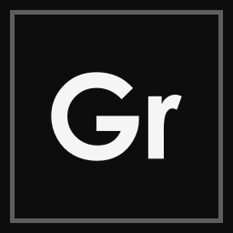
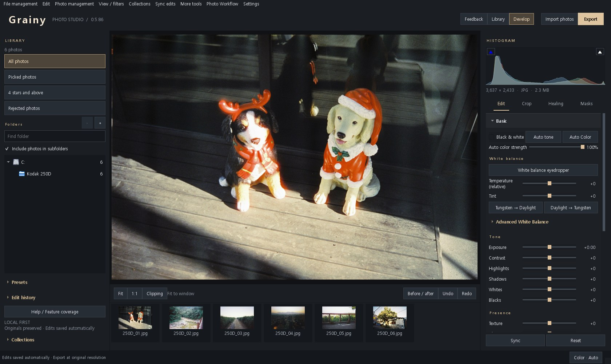
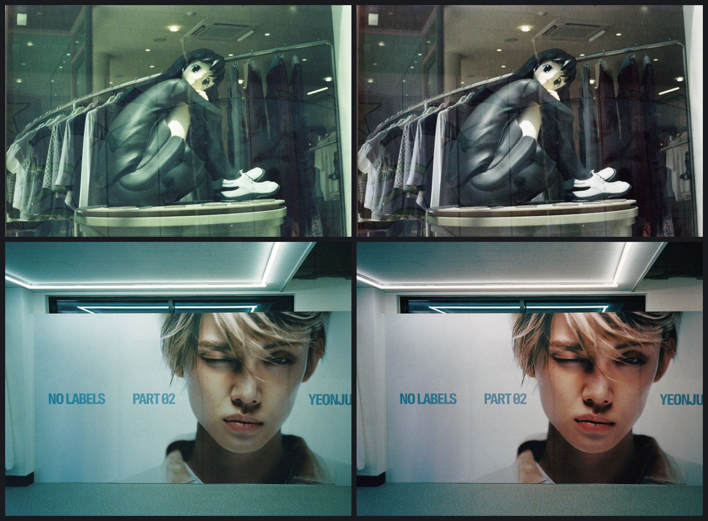
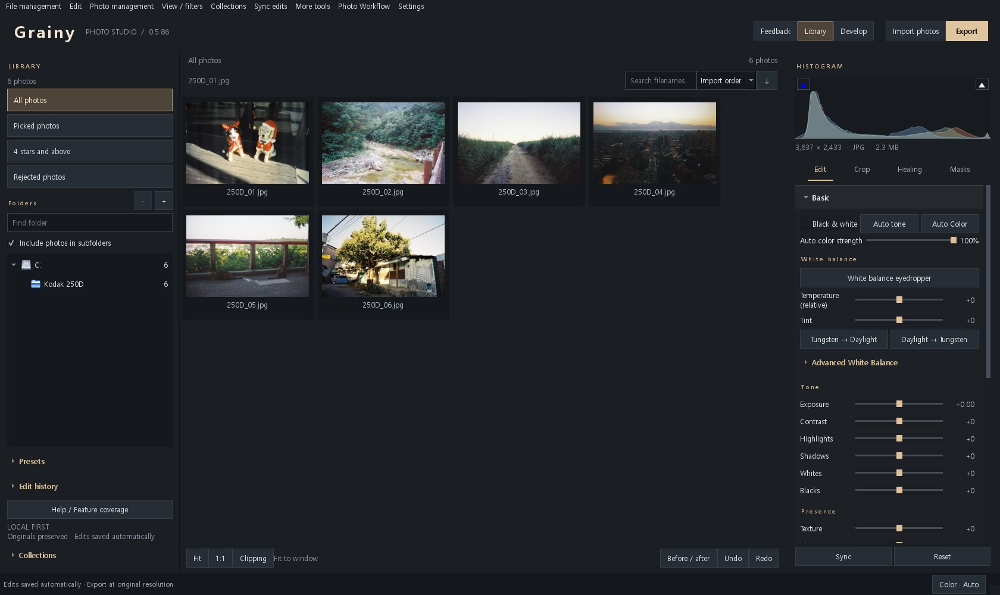
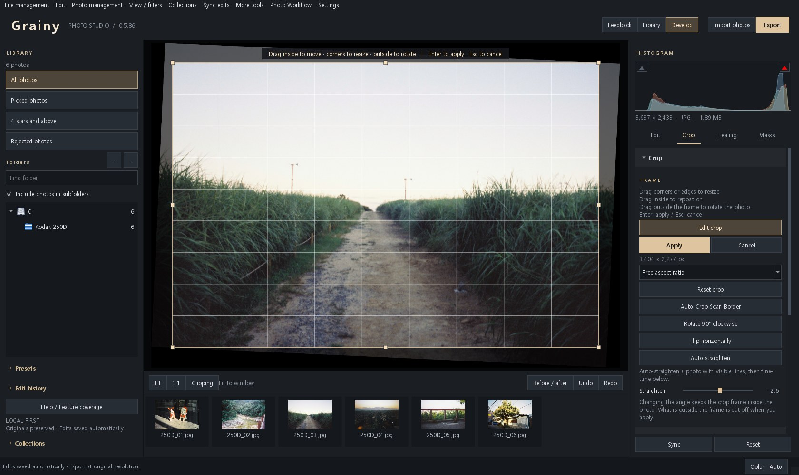
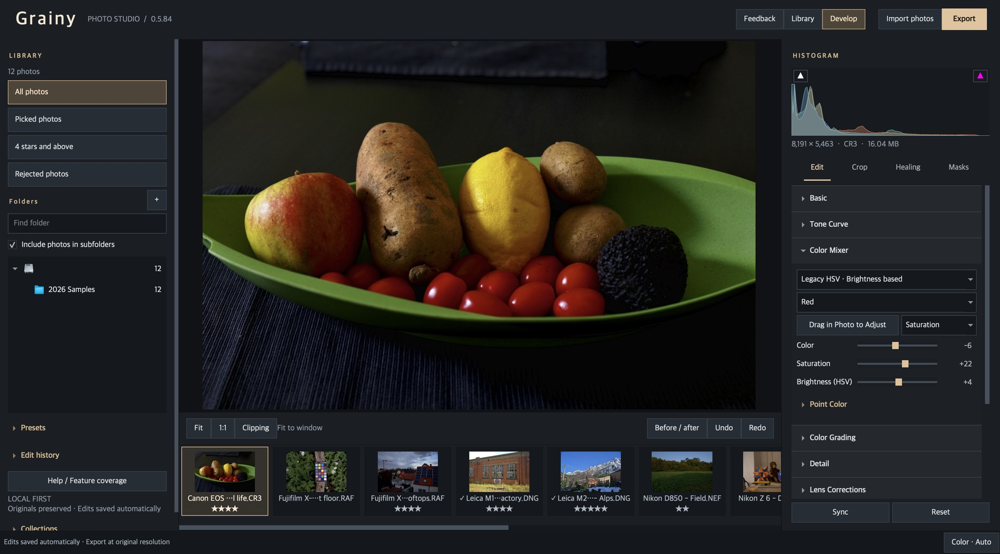
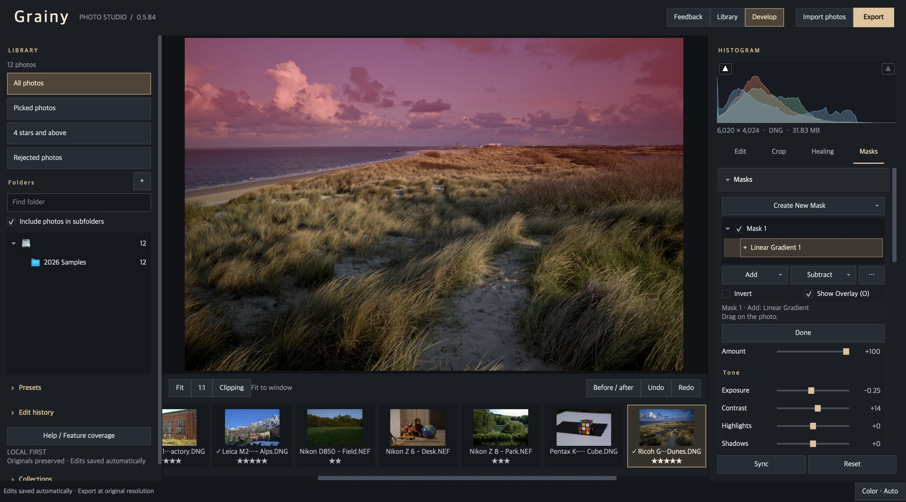

<p align="center">
  
</p>

<h1 align="center">Grainy</h1>

<h3 align="center">A free photo editor and library, made for film scans.</h3>

<p align="center">
  Fix a scan's colour cast with one button, clean up dust, crop and straighten, and keep every roll in one library.<br>
  RAW files too. No account, no subscription, and your photos never leave your computer.
</p>

<p align="center"><b><a href="https://pastorius9.github.io/grainy/">pastorius9.github.io/grainy</a></b></p>

<p align="center">
  <a href="https://github.com/pastorius9/grainy/releases/latest"></a>
  <a href="https://github.com/pastorius9/grainy/releases"></a>
  
  <a href="LICENSE"></a>
</p>

<p align="center">
  <a href="https://github.com/pastorius9/grainy/releases/latest"></a>
  &nbsp;
  <a href="https://github.com/pastorius9/grainy/releases/latest"></a>
</p>

<p align="center"><b>English</b> · <a href="README.ko.md">한국어</a></p>



## Auto tone and Auto Colour

Lab scans often come back flat, and yellow, green or blue. **Auto tone** sets the black and white points of the picture. **Auto Colour** looks at the shadows, the midtones and the highlights separately and corrects each with channel curves, because a film scan is rarely off by the same amount everywhere. One white balance value cannot do that.



Left: the scans as they came from the lab. Right: after one press of Auto tone and one of Auto Colour, with no other adjustment.

- Photos lit by coloured light (a concert, a neon sign) are left alone.
- A strength slider sets how far the correction goes. A very strong cast does not come back completely.
- Tungsten film shot in daylight, or the other way round, has its own one-button conversion.

## Why Grainy

- **Free and local.** No account, no subscription, no usage statistics. Photos and edits stay on your computer, and your originals are never modified.
- **Made for film scans.** Negative conversion, Auto Colour, automatic detection of dust and scratches that you review before anything is removed, cropping of scan borders, grain.
- **RAW development.** 14 of 15 public RAW samples open: Canon, Nikon, Fujifilm (X-Trans), Leica, Sony, Panasonic, Olympus, Pentax, Ricoh. Nikon's High Efficiency (HE) compressed NEF does not.
- **GPU acceleration.** Direct3D 11 on Windows, Metal on macOS. On an M1 Pro, fully developing a 24 MP photo (with noise reduction and sharpening) took 8.2 s on the CPU alone and 1.6 s with acceleration (measured once). The accelerated result is within one 8-bit step of the CPU result.
- **Lightroom catalogs.** Imports Lightroom catalogs (ratings, flags, collections, develop settings) and presets.

## Screens

### Library

Register a folder and new photos are imported as they appear. Organise with ratings, flags, colour labels, keywords, collections and smart collections.



### Crop and straighten

Auto straighten finds the angle and puts it on the slider. Drag outside the frame to turn the photo; the crop frame follows so that no empty corner is left.



### Tone and colour

Exposure, tone and channel curves, an eight-colour mixer, colour grading, camera profiles (DCP) and lens corrections (Lensfun). Edits are recorded as you make them, with no Save button, and every step can be undone.



### Local adjustments

Select areas with a brush, linear and radial gradients, or colour and luminance ranges, and combine them by adding, subtracting and intersecting. Below, a linear gradient on the sky only.



### RAW, as imported and developed


Left: the RAW file as imported. Right: with basic adjustments and the sky mask above.

The film scans on this page are the author's own. The other photos are CC0 samples from [raw.pixls.us](https://raw.pixls.us) (Leica M (Typ 240), Ricoh GR III, Canon EOS R5 and others). The screenshots were taken by driving the real program automatically.

## Download and run

### Windows

1. Download `Grainy-<version>-windows-x64.zip` from Releases and unpack it wherever you like.
2. Run `Grainy.exe`.
3. The program is not code-signed, so Windows shows an "unknown publisher" warning the first time.

- Windows 10/11, 64-bit.
- The library is created in `%LOCALAPPDATA%\Luma\Library`.

### macOS (Apple Silicon)

1. Download `Grainy-<version>-macos-arm64.dmg` from Releases, open it and drag Grainy to the Applications folder.
2. On first start macOS blocks the app as coming from an unidentified developer. Press "Open Anyway" once in `System Settings → Privacy & Security`. The app has no Apple developer signature or notarization.

- An Apple Silicon Mac (M1 or later) and macOS 14 or later. Intel Macs are not supported.
- The library and settings are created in `~/Library/Application Support/Grainy/`.
- 0.5.84 is the first macOS release. It passes the automated tests but has not been used on many people's Macs. Please report problems with the Feedback button.

## Uninstall

- Windows: delete the unpacked Grainy folder. Nothing is written to the registry or system settings.
- To remove the edits as well, delete `%LOCALAPPDATA%\Luma` (library) and `%LOCALAPPDATA%\Grainy` (settings). Your original photos are not in these folders.
- macOS: move Grainy from the Applications folder to the Trash. To remove the edits as well, delete `~/Library/Application Support/Grainy`.

## Features

- **Library**: import folders, automatic import of new photos in registered folders, ratings, colour labels and keywords, collections and smart collections, recovery of moved folders
- **RAW development**: RAW files of the major camera makers, camera profiles (DCP), lens corrections (Lensfun)
- **Film negatives**: one button turns a scanned negative into a positive (film base removed per channel); every other tool then works on the positive. A roll scanned with the same settings can be measured as one, so every frame is converted with the same colour reference
- **Film looks**: 82 named films (Kodak Portra, Ektar, Kodachrome, Tri-X, Vision3, Fujifilm Velvia, Provia, Acros, Ilford HP5, Delta and more), each computed from its maker's published technical data — spectral sensitivity, characteristic curves and dye densities — and printed on the paper it was made for (slides are viewed as they are), with an amount slider and the film's grain
- **Adjustments**: exposure, tone curve, channel curves, colour mixer, colour grading, auto tone, auto colour (colour-cast correction), film colour-temperature conversion (tungsten ↔ daylight)
- **Detail**: sharpening, noise reduction, grain, vignette
- **Local adjustments**: masks (brush, linear and radial gradients, colour and luminance ranges, add / subtract / intersect), healing, dust removal
- **Export**: JPEG, PNG, TIFF, AVIF, JPEG XL
- **Feedback**: a button at the top of the window sends a problem report or an idea
- **Updates**: the program checks for a new version and replaces itself
- **AI connection**: install Grainy's MCP once with one command in an AI program on this computer (Claude Code, Codex, Claude Desktop), and while Grainy is running that program can list, look at, edit and export your photos with Grainy's own tools; every AI edit is one batch you can undo
- **Also**: edit history and undo, Lightroom catalog and preset import, catalog backup (including a Google Drive folder), a GPS map

The full manual ships with the program (`README.html`, in Korean).

## Privacy

- No usage statistics are collected. Only two things go to the internet, and both only when you ask.
- **Feedback**: pressing Send transmits the text you typed, the Grainy version, a one-line system description (operating system version and graphics adapter name) and a random five-character reference number. The reference is also kept on your computer so that a later update can tell you when your feedback was addressed. Photos, file names and paths, and user names are not sent.
- **Updates**: the latest version information is read from GitHub only when you press "Check for Updates" or have switched on the automatic check (you are asked at first start, and it can be switched off in Settings). Nothing about you is sent.
- **AI connection**: the connection is on while Grainy runs (Settings › AI Connection (MCP) can switch it off), but nothing is read and nothing leaves the computer unless you install Grainy's MCP in an AI program on this computer (Claude Code, Codex, Claude Desktop) and ask that program to work. It can then read the photo list and photo details: file names and full file and folder paths (which include your user name), keywords, ratings, camera, lens, exposure settings and capture date, but not GPS location. It can also read edit values and previews up to 1568 pixels, including contact sheets of up to 36 photos. It can change edit values and export copies into the AI export folder (Pictures/Grainy unless you change it, or a subfolder of it) or into the folder of your last export. What it reads goes to that AI program's service under its own terms, and AI programs may keep their own copies, for example in conversation logs. Grainy itself never sends photos anywhere. The connection is open only on this computer and needs a key that Grainy keeps in plain text in its own settings folder; the installed MCP reads it from there, so the key is not put into the AI programs' configuration (unless you set up a direct HTTP connection under Advanced). Original files are never changed. AI edits can be undone, most recent first, for the last 5 AI tasks as long as their photos were not edited again; each photo the AI edits first also gets a "Before AI edits" snapshot. Exports cannot be undone.

## Use Grainy from an AI program (optional)

Grainy only has to be running. Install its MCP once in the AI program you use; the commands are the same on every computer and hold no key. **Settings › AI Connection (MCP)…** in Grainy shows them too, with **Copy** buttons. Run Grainy once first: it puts the bridge that these commands start into its own folder (`%LOCALAPPDATA%\Grainy\mcp` on Windows, `~/Library/Application Support/Grainy/mcp` on macOS).

1. Install it in the program you use:
   - **Claude Code**, in PowerShell (Windows), then restart Claude Code and check with `claude mcp list`:
     ```powershell
     claude mcp add --scope user grainy '--' powershell -NoProfile -ExecutionPolicy Bypass -File "$env:LOCALAPPDATA\Grainy\mcp\grainy-mcp-bridge.ps1"
     ```
     in Terminal (macOS):
     ```bash
     claude mcp add --scope user grainy -- sh "$HOME/Library/Application Support/Grainy/mcp/grainy-mcp-bridge.sh"
     ```
   - **Codex**, in PowerShell (Windows), then restart Codex and check with `codex mcp list`:
     ```powershell
     codex mcp add grainy '--' powershell -NoProfile -ExecutionPolicy Bypass -File "$env:LOCALAPPDATA\Grainy\mcp\grainy-mcp-bridge.ps1"
     ```
     in Terminal (macOS):
     ```bash
     codex mcp add grainy -- sh "$HOME/Library/Application Support/Grainy/mcp/grainy-mcp-bridge.sh"
     ```
   - **Claude Desktop**: open Settings › Developer › Edit Config, put the `"grainy"` entry inside `"mcpServers"` (if the file is empty, paste all of it) and restart Claude Desktop. Windows:
     ```json
     {"mcpServers": {"grainy": {"command": "powershell", "args": ["-NoProfile", "-ExecutionPolicy", "Bypass", "-Command", "& (Join-Path $env:LOCALAPPDATA 'Grainy\\mcp\\grainy-mcp-bridge.ps1')"]}}}
     ```
     macOS:
     ```json
     {"mcpServers": {"grainy": {"command": "/bin/sh", "args": ["-c", "exec /bin/sh \"$HOME/Library/Application Support/Grainy/mcp/grainy-mcp-bridge.sh\""]}}}
     ```
2. Ask, for example: "Show me roll 12 as a contact sheet, then invert the negatives as one roll and even out the exposure." Each change is one batch: ask the AI to undo it, or use **Undo Last AI Task** in Grainy's AI Connection window.

On Windows keep the quotes around `'--'`: without them PowerShell drops the `--` when claude or codex was installed with npm. The AI program may be started before Grainy. While Grainy is not running, or its AI connection is switched off, the program still lists Grainy's tools, and a call answers that Grainy is not running and how to fix it. Programs that connect over HTTP directly use the address and the key under **Advanced** in the same window; after **New Key** or **Use Another Port** set those up again, while programs installed as above keep working.

## Run from source

```bash
python -m venv .venv
.venv\Scripts\pip install -r requirements.txt
.venv\Scripts\python main.py
```

The C++ modules for GPU acceleration and colour conversion are built with `tools/build_native_*.py` (Visual Studio C++ tools on Windows; `tools/build_native_macos.py` with the Xcode command line tools on macOS). Run the tests with `python tools/check.py`: more than 1,200 of them.

## License

Grainy's own code is under the [MIT License](LICENSE). You may use, modify, redistribute and sell it, keeping the copyright notice and the license text. The name "Grainy" and the logo are not covered by the license.

Third-party components keep their own licenses: Qt/PySide6 (LGPL-3.0), LibRaw, OpenCV, Lensfun and others. The full list and terms are in [DISTRIBUTION.md](DISTRIBUTION.md) (Korean); the notices are in the `THIRD_PARTY_LICENSES` folder of a release.

Adobe, Lightroom and Photoshop are trademarks of Adobe Inc. Grainy is an independent project: it is not made, sponsored or endorsed by Adobe and is not affiliated with it.

Film and paper names (Kodak, Portra, Kodachrome, Fujifilm, Velvia, Ilford, HP5 and the others in the Film panel) are trademarks of their owners, among them Eastman Kodak Company, Kodak Alaris, FUJIFILM Corporation, Harman Technology, FOMA BOHEMIA, Agfa-Gevaert and CineStill. Grainy is not made, sponsored or endorsed by, or affiliated with, any of them; its film looks are simulations computed from their published technical data. The CIE colorimetric data they use is under CC BY-SA 4.0 (see `THIRD_PARTY_LICENSES/Film`).

## Code signing policy

Release binaries are **not signed yet**. This project has applied for free code signing for open source projects:

Free code signing provided by [SignPath.io](https://signpath.io), certificate by [SignPath Foundation](https://signpath.org).

- **Committers and reviewers:** [pastorius9](https://github.com/pastorius9)
- **Approvers:** [pastorius9](https://github.com/pastorius9)
- Only binaries built from this repository are signed. Third-party libraries shipped with Grainy keep their own publishers' signatures.
- Signed releases are built from source by GitHub Actions ([build.yml](.github/workflows/build.yml)) on a GitHub-hosted runner; the native libraries are compiled there as well.

**Privacy policy:** This program will not transfer any information to other networked systems unless specifically requested by the user or the person installing or operating it. There are two such requests. The Feedback dialog: pressing Send transmits the text you typed, the Grainy version, a one-line system description (operating system version and graphics adapter name) and a random five-character reference number. Updates: "Check for Updates" and, only if you switch it on when asked at first start (it can be switched off in Settings), a once-a-day check at start-up read the latest release information from GitHub; installing an update downloads the release file from GitHub. Photos, file names, paths and user names are never transmitted.
